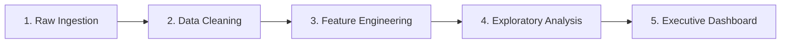

# 🇪🇬 Egyptian Real Estate Market Analysis & Executive Cockpit

[](https://www.python.org/)
[](https://streamlit.io/)
[](https://plotly.com/)
[](https://pandas.pydata.org/)
[](https://opensource.org/licenses/MIT)

An end-to-end data analytics and business intelligence solution analyzing **~40,000 property listings** across Egypt. This project combines exploratory data analysis, geospatial modeling, rental yield benchmarking, and a high-performance **Streamlit Executive Cockpit** for real-time market exploration.

---

## 📌 Executive Summary

The Egyptian real estate sector is a primary vehicle for capital preservation and wealth creation, yet market transparency across governorates has historically been fragmented. This project unifies and cleans large-scale real estate listings across **12 governorates**, **15+ major towns**, and **17 property types** to deliver actionable intelligence for investors, developers, and property buyers.

### Key Benchmark Metrics
| Metric | Sale Market (Buy) | Rental Market (Rent) |
|---|:---:|:---:|
| **Analyzed Listings** | 18,349 properties | 18,917 properties |
| **Median Market Price** | 9.80M EGP | 65,000 EGP / month |
| **Interquartile Range (IQR)** | 5.70M – 18.00M EGP | 40,000 – 100,000 EGP / mo |
| **Market Anchor** | Cairo (50.8%) & Giza (29.5%) | Cairo (80.3%) & Giza (18.1%) |
| **Overall Estimated Yield** | \~7.96% Gross Yield (Year-round Cairo: 7.60%) | — |

---

## 🛠️ End-to-End Methodology & Pipeline

The project follows a structured data analytics lifecycle divided into five key phases:



### 1. Data Collection & Sourcing
- Extracted and compiled ~40,000 real estate listings from top property portals covering sales and rentals in Egypt.
- Retained geographic coordinates (`lat`, `lon`), administrative tiers (`city`, `town`), property characteristics (`bedrooms`, `bathrooms`, `area_value`), and listing prices (`price_egp`).

### 2. Data Cleaning & Normalization
- **Room Standardizations**: Converted text labels into numerical equivalents (`Studio` $\rightarrow$ 1, `7+` $\rightarrow$ 7, `None` $\rightarrow$ 0).
- **Outlier Mitigation**: Filtered unfeasible pricing anomalies and non-residential errors using Interquartile Range (IQR) and 95th/99th percentile capping.
- **Handling Missing Geolocation**: Cleaned incomplete latitude/longitude coordinates to prepare for geospatial plotting.
- **Deduplication**: Eliminated duplicate listings across multi-agency postings.

### 3. Feature Engineering
- **Price per Square Meter (`price_per_sqm`)**: Calculated normalized cost metrics across all unit sizes (`price_egp / area_value`).
- **Scaled Denominations**: Added `price_million` (M EGP for sale) and `price_thousand` (K EGP for monthly rent) for intuitive visualization and reporting.
- **Rental Yield Modeling**: Implemented gross rental yield estimation:
  $$\text{Gross Annual Yield (\%)} = \left(\frac{\text{Median Monthly Rent} \times 12}{\text{Median Sale Price}}\right) \times 100$$

### 4. Exploratory Data Analysis (EDA)
- In-depth Jupyter Notebook analyses exploring price distribution skewness, density curves, correlation matrices, and regional price spreads.
- Detailed findings documented in [`insights_and_recommendations.md`](insights_and_recommendations.md).

### 5. Interactive Streamlit Executive Cockpit
- Engineered a production-ready dashboard ([`app.py`](app.py)) enabling interactive slicing, filtering, geospatial mapping, and yield comparison.

---

## 🖥️ Executive Analytics Cockpit (`app.py`)

The application provides an ultra-responsive, zero-gap dashboard designed for real estate decision-makers.

### Features
- **3 Analytical Modes**:
  - `🏢 Buy (Sale)`: Benchmarks capital expenditures, price/sqm, and property types.
  - `🔑 Rent`: Analyzes monthly rental rates and tenant demand.
  - `⚖️ Compare (All)`: Simultaneously evaluates sale vs. rent metrics and calculates live **Gross Rental Yield**.
- **Dynamic Multiselect Filters**: Filter by Governorate/City, Town, Property Type (Apartment, Villa, Duplex, Townhouse, Chalet), Bedrooms, Area range slider, and Price range slider.
- **6 Real-time KPI Cards**: Matching Units, Median Price, Price per SQM, Area / Est. Gross Yield, Average Bedrooms, and Sample Coverage.
- **2x3 Responsive Plotly Chart Grid**:
  1. 📍 **Geospatial Property Distribution**: Interactive OpenStreetMap plotting sampled listings with custom hover details.
  2. 🍩 **Market Concentration Donut**: Property type breakdown with centered dynamic share percentage.
  3. 📊 **Top Locations by Volume**: Horizontal ranking of top governorates using the Viridis color scale.
  4. 🔢 **Feature Correlation Matrix**: Heatmap examining relationships between Price, Area, Bedrooms, Bathrooms, and Price/SQM.
  5. 📦 **Price Distribution Box Plot**: Statistical dispersion and quartile distributions across property types.
  6. 🏙️ **Median Property Price by Location**: Horizontal bar chart comparing localized median costs and sample sizes.

---

## 📈 Key Market Findings & Strategic Insights

1. **Greater Cairo Monopoly**:
   - Cairo and Giza represent **80.3% of all sale listings** and **98.4% of all rental listings**.
   - Outside Cairo and Giza, rental markets are virtually non-existent, pointing to an investor-dominated rather than resident-dominated market in coastal cities.
2. **The North Coast Paradox**:
   - North Coast holds Egypt's highest property prices (**13.0M EGP median**, **96,235 EGP/sqm**), commanding a 66% premium over Cairo.
   - While raw annualized yield appears high (~38.8%), occupancy is strictly seasonal (~3 months of summer). When adjusted for seasonality, the actual annualized yield normalizes to **~10%**.
3. **Cairo Yield Consistency**:
   - Cairo represents the most resilient investment market with an annualized gross yield of **7.60%**, supported by year-round domestic and foreign tenant demand.
4. **Massive Town-Level Price Spread**:
   - Property prices display a **7.4× spread** between high-end resort areas (Sidi Abdel Rahman at ~119K EGP/sqm) and affordable commuter towns (Hadayek El Ahram at ~16K EGP/sqm).
5. **Dominance of Apartments**:
   - Apartments account for 52.4% of sales and 73.8% of rentals, making them the safest asset class with the highest tenant turnover.

For the complete strategic report, see [`insights_and_recommendations.md`](insights_and_recommendations.md).

---

## 📂 Repository Structure

```plaintext
Egyptian_RealEstate_analysis/
│
├── app.py                             # Interactive Streamlit Executive Cockpit
├── requirements.txt                   # Application dependencies
├── README.md                          # Comprehensive project documentation
├── insights_and_recommendations.md    # Detailed real estate business report
│
├── Rent (Cleaned).csv                 # Cleaned rental properties dataset (~18.9k rows)
├── Sell (Cleaned).csv                 # Cleaned sale properties dataset (~18.3k rows)
│
├── visualization.ipynb                # Interactive visualizations & charting notebook
├── Egyption_Real_Estate_2026.ipynb    # Main data cleaning & EDA notebook
├── project real.stat 2026.ipynb       # Statistical exploration & modeling
├── RE.ipynb                           # Additional exploratory analysis
│
└── .gitignore                         # Excludes cache, checkpoints, and raw heavy files
```

---

## 🚀 Getting Started & Installation

### 1. Clone the Repository
```bash
git clone https://github.com/moatasimyakoub92-dot/Egyptian_RealEstate_analysis.git
cd Egyptian_RealEstate_analysis
```

### 2. Set Up a Virtual Environment
```bash
# Windows
python -m venv .venv
.venv\Scripts\activate

# macOS / Linux
python3 -m venv .venv
source .venv/bin/activate
```

### 3. Install Required Dependencies
```bash
pip install -r requirements.txt
```

### 4. Launch the Interactive Dashboard
```bash
streamlit run app.py
```
Once executed, the dashboard will open automatically in your browser at `http://localhost:8501`.

---

## 🧰 Tech Stack
- **Language**: Python 3.10+
- **Data Manipulation & Analysis**: Pandas, NumPy
- **Interactive Visualization**: Plotly Express & Plotly Graph Objects
- **Dashboard Framework**: Streamlit
- **Version Control**: Git & GitHub

---

## 👤 Author
- **Mo3taz Ibrahim** — [GitHub Profile](https://github.com/moatasimyakoub92-dot)
- **Repository**: [Egyptian_RealEstate_analysis](https://github.com/moatasimyakoub92-dot/Egyptian_RealEstate_analysis)

---

## 📄 License
This project is open-source under the [MIT License](LICENSE).
